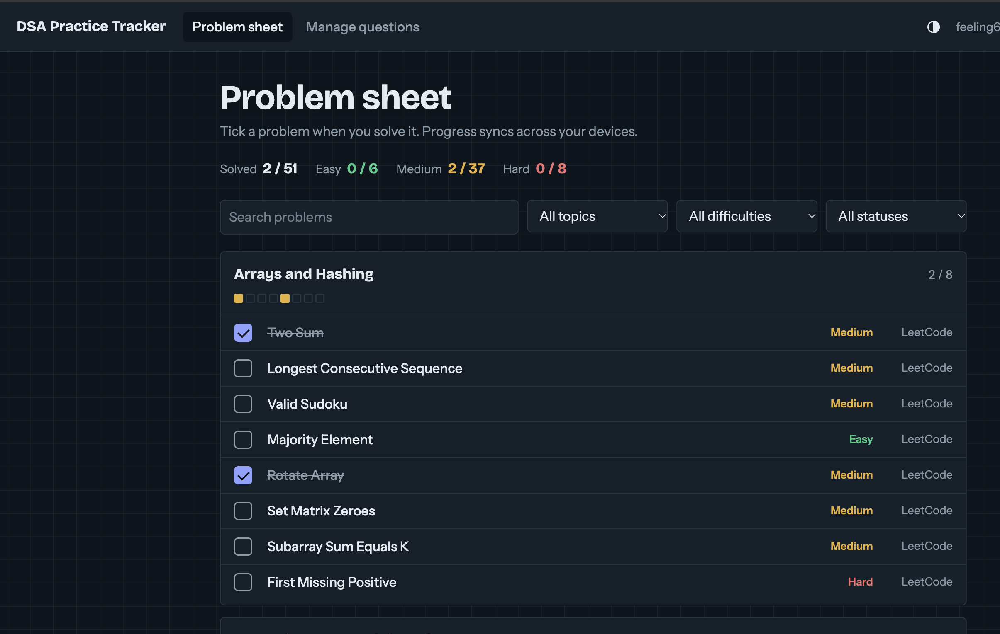
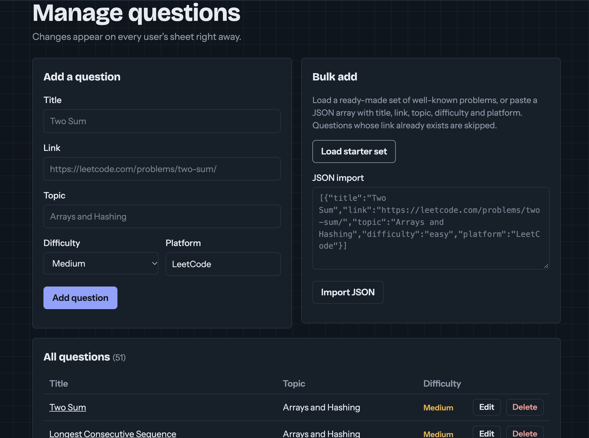

# DSA Practice Tracker

A web app for tracking Data Structures and Algorithms practice. The problem sheet is organized by topic and difficulty, and each user's progress syncs across devices.

**Stack:** HTML, CSS, JavaScript (ES modules), Firebase Auth, Cloud Firestore, GitHub Pages.

## Features

- Email/password and Google sign-in with Firebase Auth
- Per-user progress stored in Cloud Firestore, updated in real time across devices
- Admin panel to add, edit, delete and bulk-import questions without touching code
- Role-based access control enforced by Firestore security rules
- Filters for topic, difficulty and solved status, plus search
- Topic progress strips: one cell per problem, colored by difficulty once solved
- Responsive layout with a dark/light theme toggle that remembers your choice

## Project structure

```
index.html
css/style.css
js/app.js               auth, Firestore sync, rendering, admin panel
js/firebase-config.js   your Firebase web config (edit this)
js/seed.js              starter set of 41 problems
firestore.rules         security rules (deploy these)
```

## Setup

### 1. Create the Firebase project

1. Go to the [Firebase Console](https://console.firebase.google.com) and create a project.
2. **Authentication > Sign-in method:** enable **Email/Password** and **Google**.
3. **Firestore Database:** create a database (production mode is fine).
4. **Project settings > Your apps:** add a **Web app**, then copy the config object into `js/firebase-config.js`.

### 2. Deploy the security rules

Open **Firestore Database > Rules**, paste the contents of `firestore.rules`, and publish.

Or with the Firebase CLI:

```
npm install -g firebase-tools
firebase login
firebase init firestore      # choose your project, keep firestore.rules
firebase deploy --only firestore:rules
```

Do not skip this step. The Firebase config in `firebase-config.js` is public by design, and the rules are what protect your data.

### 3. Run locally

ES modules need a web server (opening `index.html` directly will not work):

```
python -m http.server 8000
```

Then open <http://localhost:8000>. Add `localhost` under **Authentication > Settings > Authorized domains** if it is not already listed.

### 4. Make yourself an admin

1. Open the site and create an account.
2. In the Firebase Console go to **Firestore Database > users** and open the document whose ID matches your user ID (shown under **Authentication > Users**).
3. Change the `role` field from `user` to `admin`.
4. Refresh the site. A **Manage questions** tab appears. Use **Load starter set** to fill the sheet.

Users cannot change their own role: the rules reject it.

### 5. Deploy to GitHub Pages

1. Push the project to a GitHub repository.
2. **Settings > Pages:** choose the branch and the root folder.
3. Add your Pages domain (for example `yourname.github.io`) under **Firebase Authentication > Settings > Authorized domains**, otherwise Google sign-in will fail on the live site.

## Data model

```
questions/{questionId}
  title, link, topic, difficulty (easy | medium | hard), platform, order, createdAt

users/{uid}
  email, role (user | admin), createdAt

users/{uid}/progress/{questionId}
  solved: true, solvedAt
```

Deleting a progress document marks a problem as unsolved.

##Project Images

**User Interface**


**Manage Question For ADMIN**


## Ideas for next steps

- Per-problem notes and revision dates
- A streak calendar built from `solvedAt`
- Company tags and a "revise later" flag
